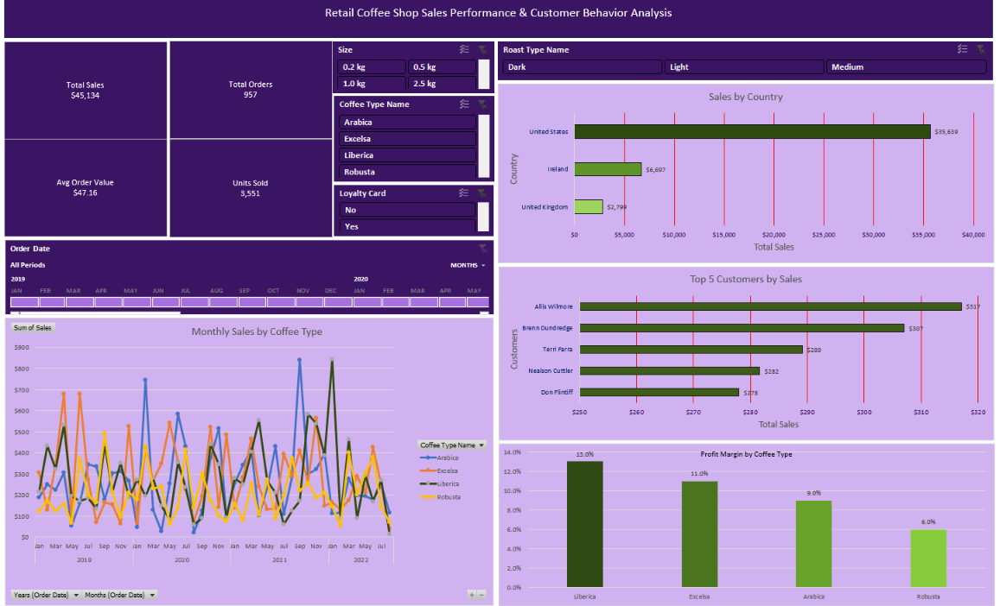

# ☕ Coffee Sales Analysis Dashboard (Excel)

An interactive Excel dashboard that analyses 1,000 coffee order lines (Jan 2019 – Aug 2022) across the United States, Ireland and the United Kingdom. It combines three relational tables, formula-driven data enrichment, PivotTables and slicers to answer: **what sells, where, to whom, and at what margin?**

<!-- Add a screenshot of the Dashboard sheet here: -->
<!--  -->

---

## Key Insights

| Metric | Value |
|---|---|
| Total sales | **$45,134** |
| Total orders | **957** (1,000 order lines) |
| Units sold | **3,551** |
| Average order value | **$47.16** |
| Total profit | **$4,520** (≈ **10.0%** overall margin) |

- **The US dominates:** about 79% of sales (~$35.6K), followed by Ireland (~$6.7K, 15%) and the UK (~$2.8K, 6%).
- **Margins differ by bean:** Liberica earns the highest margin (13%), then Excelsa (11%), Arabica (9%) and Robusta (6%).
- **Sales are spread evenly across the four coffee types:** Excelsa leads slightly (~$12.3K), and Robusta trails (~$9.0K) while also having the lowest margin.
- **Monthly sales are volatile:** the best month was Feb 2020 (~$1,798). 2021 was the strongest full year (~$13.8K).
- **The customer base is broad:** the top 5 customers account for only about 3% of sales, so revenue is not dependent on a few big buyers.
- **2022 is a partial year** (data ends 19 Aug 2022), so it should not be compared directly with full years.

---

## Dashboard Contents

| Sheet | Purpose |
|---|---|
| `Dashboard` | Final view: 4 charts, KPI cards and interactive slicers |
| `orders` | Order-level fact table (1,000 rows) enriched with lookup formulas |
| `Customers` | Customer master data (1,000 customers) |
| `products` | Product catalogue (48 SKUs: 4 coffee types × 3 roasts × 4 sizes) with unit price and profit |
| `KPI` | PivotTable feeding the KPI cards |
| `TotalSales` | Monthly sales by coffee type (feeds the line chart) |
| `CountryBarChart` | Sales by country |
| `Profit` | Profit margin by coffee type |
| `Top5 Customers` | Top 5 customers by sales |

### Charts and interactivity
- Monthly sales by coffee type (line)
- Sales by country (bar)
- Top 5 customers by sales (bar)
- Profit margin by coffee type (bar)
- Slicers and timeline: **Order Date, Coffee Type, Roast Type, Size, Loyalty Card**

---

## Data Model

```
Customers (Customer ID) ──┐
                          ├──< orders >── products (Product ID)
```

The raw `orders` columns are Order ID, Order Date, Customer ID, Product ID and Quantity. All other columns are looked up or calculated:

| Column | Logic |
|---|---|
| Customer Name, Email, Country, Loyalty Card | `XLOOKUP` into `Customers` on Customer ID |
| Coffee Type, Roast Type, Size, Unit Price | `INDEX / MATCH` into `products` on Product ID |
| Sales | `Unit Price × Quantity` |
| Coffee Type Name | Expands codes (Ara, Rob, Lib, Exc) into full names |
| Roast Type Name | `SWITCH` expands L / M / D into Light / Medium / Dark |
| Order Share | `1 / COUNTIF(Order ID)`, so summing it counts unique orders |
| Profit Amount | `Profit per unit × Quantity` |

---

## Skills Demonstrated
- Data modelling across multiple tables
- Lookup formulas (`XLOOKUP`, `INDEX/MATCH`, `SWITCH`) and structured table references
- PivotTables and calculated measures (margin %, distinct order count)
- Dashboard design with charts, KPI cards, slicers and a timeline
- Business analysis: sales, profitability, geography and customer segmentation

---

## How to Use
1. Download `coffeeOrdersData.xlsx`.
2. Open it in **Microsoft Excel 365 / 2021 or later** (the workbook uses `XLOOKUP` and `SWITCH`, which are not available in older versions).
3. Go to the **Dashboard** sheet and use the slicers to filter the charts.
4. If you edit the data, use **Data → Refresh All** so the PivotTables update.

> **Compatibility note:** Slicers and timelines do not work in Google Sheets or LibreOffice. Use desktop Excel for the full experience.

---

## Assumptions and Limitations
- Currency is shown in `$` throughout. The source data does not state a currency, and it includes Ireland and the UK.
- Data covers 2 Jan 2019 – 19 Aug 2022; 2022 is incomplete.
- Some customers have no email (about 20% of order lines) or no phone number on record.
- Profit is calculated from a fixed margin per product, not from actual cost data.

---

## Repository Structure
```
├── coffeeOrdersData.xlsx   # Full workbook with data, pivots and dashboard
├── Dashboard.png                 # Dashboard screenshots
└── README.md
```

## Author
**[Your Name]** · [LinkedIn](https://linkedin.com/in/your-profile) · [Email](mailto:you@example.com)

<!-- If the dataset comes from a course or public source, credit it here. -->
